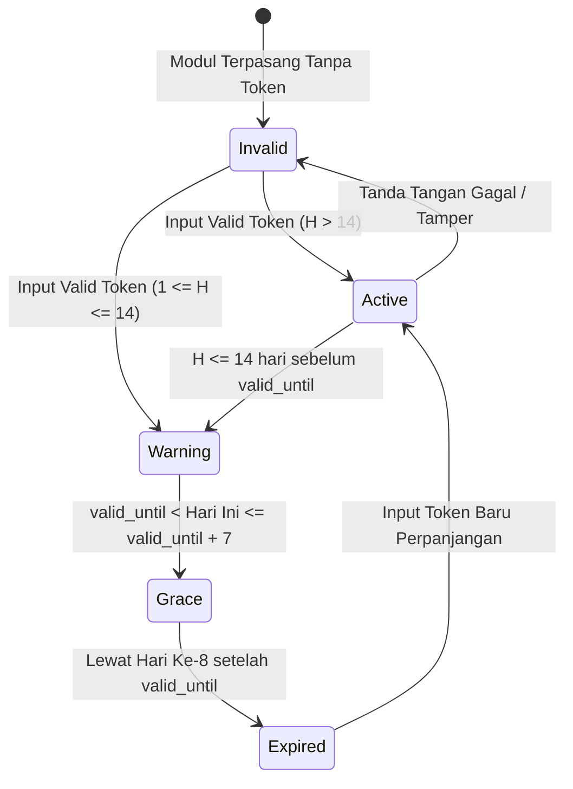

# Data Model Specification: `pos_saas_license`

**Feature**: `001-pos-saas-license`  
**Date**: 2026-10-06  
**Status**: Completed (Phase 1)

---

## 1. Entity: `pos.saas.license`

Model data utama yang menyimpan status lisensi aktif sistem per database tenant.

### Fields Definition

| Field Name | Type | Properties | Description |
| :--- | :--- | :--- | :--- |
| `name` | Char | Required, Default="SaaS License" | Label representasi rekaman |
| `license_id` | Char | Readonly, Index | ID lisensi unik dari SaaS Provider (misal: `LIC-2026-001`) |
| `merchant_name` | Char | Readonly | Nama penyewa/merchant yang tertera pada lisensi |
| `license_type` | Selection | Required, `[('subscription', 'Subscription'), ('perpetual', 'Perpetual (Beli Putus)')]` | Jenis model lisensi |
| `database_uuid` | Char | Readonly | Database UUID Odoo yang terikat |
| `raw_token` | Text | Required | String token mentah (Base64/JWT) yang dimasukkan pengguna |
| `valid_from` | Date | Readonly | Tanggal awal mulai berlaku |
| `valid_until` | Date | Readonly | Tanggal jatuh tempo kedaluwarsa (False/Null untuk perpetual) |
| `grace_period_days` | Integer | Default=7 | Jumlah hari masa tenggang toleransi |
| `max_pos_registers` | Integer | Default=1 | Kuota jumlah register/pos.config yang diizinkan |
| `state` | Selection | Default='invalid', `[('active', 'Active'), ('warning', 'Expiring Soon'), ('grace', 'Grace Period'), ('expired', 'Expired'), ('invalid', 'Invalid Token')]` | Status siklus hidup lisensi |
| `days_remaining` | Integer | Computed | Sisa hari aktif sebelum jatuh tempo |
| `last_verified_at` | Datetime | Readonly | Timestamp verifikasi kriptografis terakhir |
| `last_seen_timestamp` | Datetime | Stored | Timestamp transaksi terakhir (deteksi clock rollback) |

### State Machine Lifecycle



---

## 2. Entity: `pos.saas.license.log`

Model audit trail untuk mencatat seluruh riwayat aktivitas, verifikasi, dan insiden keamanan terkait lisensi.

### Fields Definition

| Field Name | Type | Properties | Description |
| :--- | :--- | :--- | :--- |
| `license_id` | Many2one | `pos.saas.license`, Ondelete='cascade' | Relasi ke entitas lisensi |
| `event_type` | Selection | Required, `[('installed', 'Token Installed'), ('verified', 'Signature Verified'), ('warning', 'Warning Triggered'), ('grace_entered', 'Grace Period Entered'), ('blocked', 'Session Open Blocked'), ('clock_tamper', 'Clock Rollback Detected'), ('invalid_token', 'Invalid Signature')]` | Kategori kejadian |
| `event_date` | Datetime | Default=now, Index | Waktu kejadian |
| `user_id` | Many2one | `res.users` | User yang memicu aksi |
| `details` | Text | Readonly | Catatan teknis & pesan error |

---

## 3. Odoo 20 Model Extensions: `pos.config` & `pos.session`

### 3.1. `pos.config` (Intersepsi Pembukaan UI Kasir)
* **Override Method `open_ui()`**:
  - Memanggil `self.env['pos.saas.license'].verify_active_session()`.
  - Jika lisensi `expired` atau `invalid`, melempar `UserError` informatif yang mencegah kasir membuka UI.

### 3.2. `pos.session` (Kontrol Kuota & Passing Data ke OWL)
* **Override Method `create(vals_list)`**:
  - Memeriksa kuota sesi aktif agar tidak melebihi `max_pos_registers`.
* **Override Method `open_frontend_cb()`**:
  - Memastikan sesi kasir yang di-resume memvalidasi lisensi terkini.
* **Fields untuk OWL UI**:

| Field Name | Type | Description |
| :--- | :--- | :--- |
| `license_state` | Selection | Computed dari `pos.saas.license.state` |
| `license_days_left` | Integer | Sisa hari aktif |
| `license_banner_msg` | Char | Teks pesan banner yang ditampilkan di layar kasir |

---

## 4. Odoo 20 SQL Constraints & Indexing

Sesuai standar modern Odoo 20 (menggunakan `models.Constraint` dan `models.Index` menggantikan `_sql_constraints` lama):

```python
# models/pos_saas_license.py
_constraints = [
    models.Constraint(
        "check_grace_period_positive",
        "CHECK(grace_period_days >= 0)",
        "Grace period days must be non-negative.",
    ),
    models.Constraint(
        "check_max_pos_registers_positive",
        "CHECK(max_pos_registers >= 1)",
        "Maximum POS registers quota must be at least 1.",
    ),
]

_indexes = [
    models.Index("(license_id, state)"),
]
```
